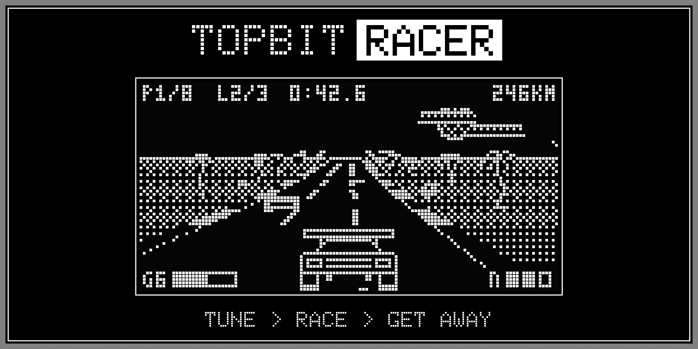
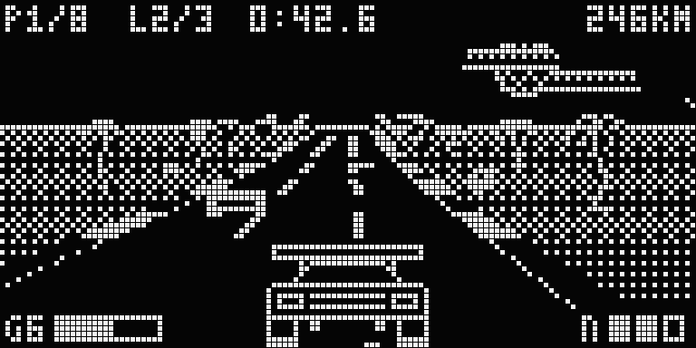
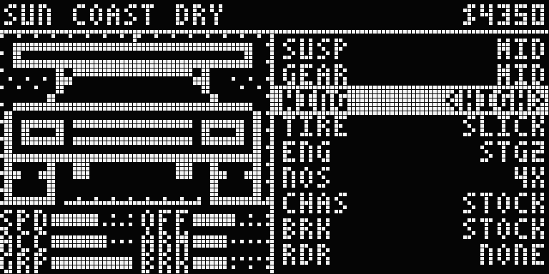
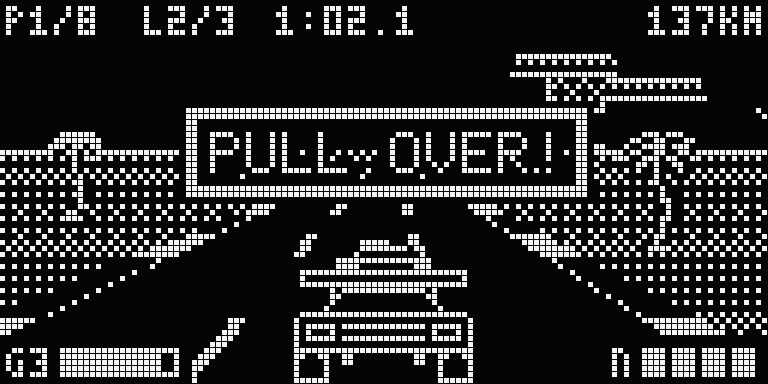

# TopBitRacer

[](https://github.com/kumodot/TopBitRacer/tags)
[](LICENSE)
[](#run-it)
[](#tech-notes)

[](https://kumodot.github.io/TopBitRacer/)
[](https://github.com/kumodot/TopBitRacer/archive/refs/heads/main.zip)
[](https://ko-fi.com/msouza3d)



A Top Gear / Enduro style racer drawn in pure 1-bit on a simulated 128x64 SSD1306 OLED. Tune the car in the garage, race three cups for prize money, buy parts, and decide if a speed trap is worth the police chase. Everything (graphics, 4-channel chip music, sound effects) is generated in one HTML file.

| | | |
|---|---|---|
|  |  |  |
| Sun Coast, lap 2, leading | Garage: live car preview, setup and parts | A speed trap went wrong |

## Run it

- **Online:** https://kumodot.github.io/TopBitRacer/
- **Local:** download the repo and double click `TopBitRacer_v0.5.1.html`. No server, no install.
- Sound starts on the first key press or tap. Progress is saved in the browser (localStorage).

### Controls

| Action | Keyboard (two hands) | Keyboard (arrows) | Gamepad | Touch |
|---|---|---|---|---|
| Gas | *W* | *Up* or *Z* | A / RT | A |
| Brake | *S* | *Down* or *X* | B / LT | B |
| Steer | *Left* / *Right* | *Left* / *Right* (or *A* / *D*) | stick / D-pad | arrows |
| Nitro | *E* or *Q* | *C*, *Space*, *Shift* | X / Y / RB | NITRO |
| Start / pause | *Enter* | *Enter* / *Esc* | Start | START |
| Music on / off | *M* | *M* | | |

## Workflow

**Career**
- Start with $1500. *ROOKIE CUP* (free, 3 short circuits), *PRO CUP* ($1000, 5 circuits), *ELITE CUP* ($3000, faster rivals).
- Prize money for every finish, counted into your bank on the payout screen. The top 3 of a cup get a bonus; win it (most points) to unlock the next cup.
- Police fines can put you in debt (shown as *DEBT -$...*): in debt only the free *ROOKIE CUP* is open until you pay it off.

**Garage** (before every race, and from the career hub)
- *SUSP* LOW / MID / HIGH: low grips better in corners but scrapes on dips and suffers on grass; high is the opposite. The car rides lower or higher on screen.
- *GEAR* SHORT / MID / LONG: acceleration versus top speed.
- *WING* NONE / LIP / HIGH: top speed versus corner grip, visible on the car.
- Part slots *TIRE*, *ENG*, *NOS*, *CHAS*, *BRK*, *RDR*, with stat bars SPD ACC GRP OFF ARM BRK.

**Shop**
- Street, slick, rain, snow and rally tires (grip per surface: dry / wet / snow / dirt), engine stages 1 to 3, nitro 4X / XL, reinforced chassis / roll cage, sport / race brakes, radar detector.
- Bought parts install right away. Sell back at 50% (press A twice).

**Race**
- Auto gearbox, nitro, skids with smoke and squeal, damage (the car explodes after too many hits and you wait to respawn).
- Pit lane on the right shoulder near the finish line: drive through it to repair damage for free (speed limited while inside). A *PIT>* hint blinks when you are damaged and it is coming up.
- Dirt sections (Green Hills, Salt Flats, Mirage Run): bumps cost speed with a low ride, rally tires grip best. The track screen shows *DIRT %*, how bumpy it is and a suspension tip.
- Conditions change every race on the same layout: day, dusk or night; clear, fog, rain, storm or snow; where the dirt sections are; puddles on a wet road. The track screen shows them (and the forecast, *LATER: RAIN?*) before the garage, so you can pick tires. Weather can change mid race.
- Broken road (about every other race): a stretch of potholes on a straight with a ramp in one lane, arrows painted on the road before it. Line up and jump it, or lose speed in the potholes (less with high suspension and rally tires). High suspension lands soft; low slams down and fishtails. Rivals jump too. Watch out for birds.
- Slipstream: sit behind a car to charge the draft (speed lines streak past), pull out sideways for a slingshot.
- Nitro refills Burnout style: *NEAR MISS* (pass a car really close) gives a quarter charge, drafting slowly tops it up. Partly filled charges show in the nitro pips.
- Off the road: bushes, signs and posts fly away; trees and palms throw you back to the road edge; buildings, rocks and lamp posts nearly stop you. The action keeps going.
- Speed traps on street circuits (not every trap is manned every lap, and not every speeder gets chased): pass above 176 km/h and a cop may chase you. The police car is solid for everyone. A wanted level (1 to 3 stars shown as `* - -`, top right) shows what you'd pay if caught: stop when told and you pay the minimum; flee (ignore the order, burn nitro, cut past it) and it goes to 2 stars; hit the cop or make it ram you and it's 3 stars, the maximum. Get away (stay out of sight for a moment, or outlast its patience) and you pay nothing.
- Levels EASY / NORMAL / HARD, 8 circuits: Sun Coast, Mirage Run, Neon Metro (tunnels), Frost Peak (snow), Storm Woods (rain, fog, lightning), Bay Street, Green Hills, Salt Flats.

## Projects / saved data

- `topbitracer_save_v1` in localStorage: money, owned parts, installed parts, setup, unlocked cups. *RESET SAVE* in the career hub starts over.
- `topbitracer_mix`: music / engine / SFX levels.

## Tech notes

- **Display:** 1024-byte page-based framebuffer (`x + (y >> 3) * 128`, LSB at the top), the SSD1306 `MONO_VLSB` layout, so the buffer can be pushed to real hardware as is. Adafruit glcdfont 5x7 plus a 3x5 HUD font.
- **Renderer:** pseudo-3D segment road drawn far to near (hills, curves, tunnels), box-sampled 1-bit sprites, Bayer dithering for gray, fog and weather.
- **Audio:** 4-channel chip engine (2 pulse, triangle, noise) with a tracker-style sequencer; sound effects steal a channel while they play. Engine drone is a separate voice. Race songs are dynamic: an intensity value from the race picks layers and nudges the tempo on beat and bar boundaries.
- **Tests:** headless Chrome (Playwright) runs full races and cups through the game loop.

## Layout

```
index.html                 Pages entry: reads version.json, opens the current build
version.json               current version + entry file
TopBitRacer_v0.5.1.html    the game (single file)
screenshots/               README images + banner
docs/                      release notes
README.md  CHANGELOG.md  LICENSE
```

## License

MIT. See [LICENSE](LICENSE).

Marcelo Souza / Kumodot.art - 2026 // @Msouza3d · [Support Marcelo Souza on Ko-fi](https://ko-fi.com/msouza3d)
